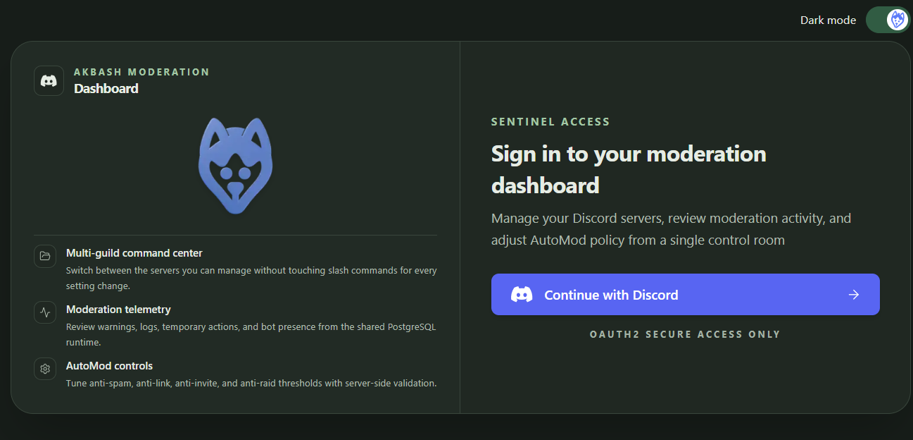
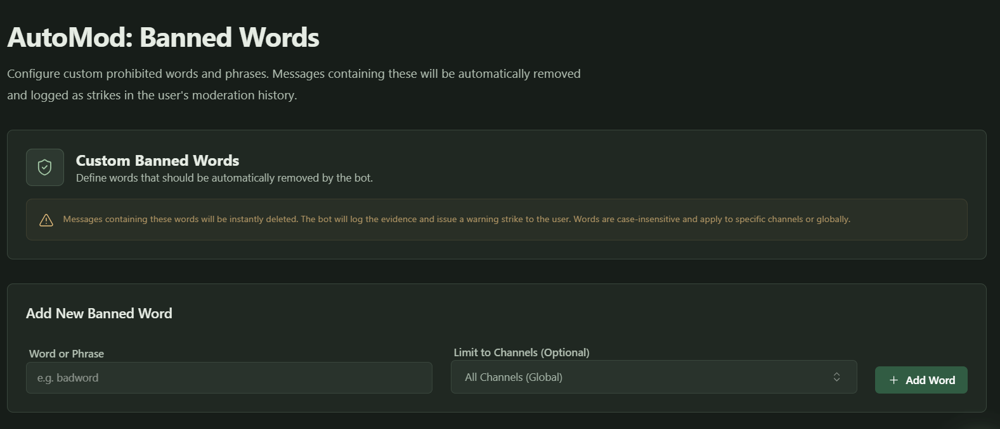
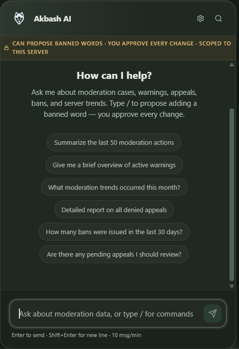

# Akbash

**Official public documentation and product showcase for Akbash, a hosted Discord moderation bot and web dashboard.**

> **Documentation only.** This repository contains product documentation, screenshots, and links to the hosted service. Akbash's application source code is maintained in private repositories. Source code is intentionally absent; this is not an unfinished open-source release or a self-hosting distribution.

[Website and dashboard](https://akbash-dashboard.escano.xyz/) · [User guide](docs/USER-GUIDE.md) · [Contact](https://akbash-dashboard.escano.xyz/contact)

## What Akbash does

Akbash brings Discord moderation and server management into one workspace:

- **Moderation and cases:** warnings, bans, kicks, timeouts, and moderation history.
- **AutoMod:** configurable spam, link, invite, raid, and banned-word controls.
- **Evidence and appeals:** review captured evidence and handle member appeals.
- **Tickets and reports:** triage support conversations and message reports, reply, and add staff notes.
- **Server tools:** command controls, custom commands, reaction roles, and emergency lockdown.
- **AI assistant:** ask about moderation context and review proposed banned-word changes before approving them.

Feature access depends on server permissions and enabled settings. See the [user guide](docs/USER-GUIDE.md) for the basic workflow.

## Get started

1. Open the [Akbash dashboard](https://akbash-dashboard.escano.xyz/).
2. Sign in with Discord and select a server you are authorized to manage.
3. Review your server's settings, moderation activity, and available controls.

Browse the screenshots below for a product preview. For access and availability questions, use the [contact page](https://akbash-dashboard.escano.xyz/contact).

## Product screenshots

These screenshots come from the public product showcase recorded in September 2026. They illustrate the product; the current interface may differ.

### Discord sign-in

### Channel-scoped AutoMod

### AI moderation assistant

## Repository scope

| Included here | Maintained privately |
| --- | --- |
| Public user documentation | Bot and dashboard application source |
| Product screenshots | Status website application source |
| Website, dashboard, legal, and support links | Build, deployment, and infrastructure configuration |

There are no application packages, install instructions, or source releases here. Use the hosted dashboard to access Akbash. This repository does not grant an open-source license to the Akbash application or access to its private source code.

## Support and feedback

- **Product support, account questions, privacy requests, and security reports:** [Contact Akbash](https://akbash-dashboard.escano.xyz/contact) or email [akbash@escano.xyz](mailto:akbash@escano.xyz).
- **Documentation corrections:** [Open a documentation issue](https://github.com/adrianjohn141/akbash/issues).
- **Legal information:** read the [Privacy Policy](https://akbash-dashboard.escano.xyz/privacy) and [Terms of Service](https://akbash-dashboard.escano.xyz/terms).

GitHub issues are public. Do not post tokens, credentials, private moderation evidence, member information, or security vulnerability details. Use the private contact channel for sensitive reports.
